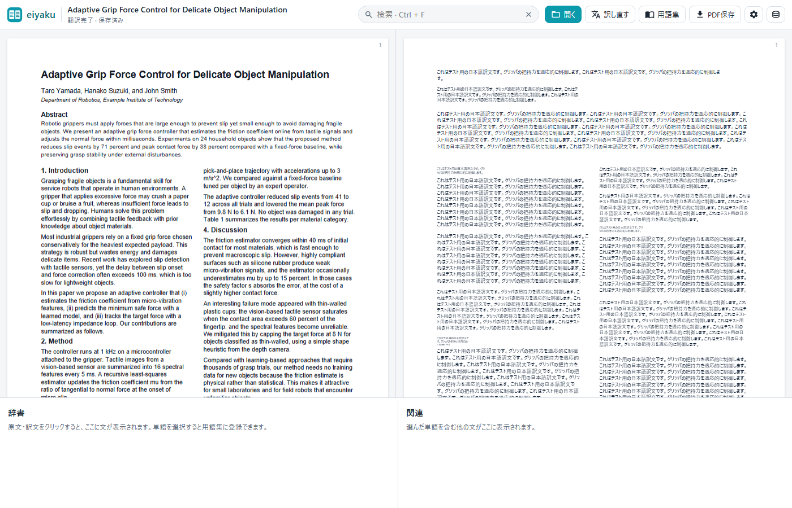

# eiyaku — PDF対訳リーダー

英語のPDF(論文など)を**もとのレイアウトのまま日本語に翻訳**し、原文と並べて読めるWebアプリです。
[taiyaku](https://taiyaku.ralutet.net/) に着想を得た、ビルド不要の静的サイトとして実装しています。



## 主な機能

- **PDFを開く**: ドラッグ&ドロップ / ファイル選択 / arXivのURL貼り付け / 見本の論文
- **レイアウト維持翻訳**: 原文の文字領域を白抜きし、同じ位置に日本語訳を重ねて表示(段組み・図表はそのまま)
- **2ペイン対訳表示**: 同期スクロール、ホイール/Ctrl+ホイールでズーム
- **翻訳エンジン2方式**
  - **ローカル**: WebLLM(WebGPU)でブラウザ内翻訳。PDFも原文テキストも外部に送信されません
  - **API**: OpenAI互換の `/chat/completions`(エンドポイント・モデル・キーを設定可能)
- **辞書パネル**: 文をクリックすると原文・訳文を表示。単語を選択して「用語集に追加」
- **関連パネル**: 選んだ単語を含む他の文を横断表示(クリックでジャンプ)
- **用語集**: 訳語を固定して再翻訳(表編集/テキスト編集)
- **検索**: 原文・日本語訳の両方を検索(Ctrl+F、Enterで次へ)
- **訳文PDF保存**: 元PDFに日本語訳を描き込んで保存(Noto Sans JP埋め込み、禁則処理付き折り返し)
- **訳文キャッシュ**: IndexedDBに保存。同じPDFを再度開くと即時表示。「保存データ」から一括管理・消去
- **設定**: テーマ(ライト/ダーク/システム)、文字サイズ、パネル位置、ページ暗色化、余白トリム、左右入れ替えなど
- 翻訳は**表示中のページを優先**して進捗表示付きで実行。停止ボタンあり

## 動作要件

- モダンブラウザ(Chrome / Edge 推奨)
- **ローカル翻訳を使う場合**: WebGPU対応ブラウザとGPU。初回のみモデルをダウンロード(約0.7〜2.5GB)し、ブラウザにキャッシュします
- WebGPU非対応の場合は設定から「API方式」に切り替えてください
- 起動には静的ファイルサーバーが必要です(`file://` ではES Modulesが動きません)

## 起動方法

```powershell
# Python がある場合
python -m http.server 8080

# または Node.js
npx serve .
```

ブラウザで <http://localhost:8080/> を開きます。

初回は「見本の論文で試す」で動作確認できます。ローカル翻訳は初回にモデルのダウンロードが入ります。

### URLパラメータ(開発・デモ用)

- `?demo=1` — 見本の論文を自動で開く
- `?demo=1&notranslate=1` — 翻訳を開始せずに開く

## プライバシー

- ローカル方式では、PDF・原文テキスト・訳文はすべて端末内で処理されます
- API方式では、**原文テキストのみ**が設定したエンドポイントに送信されます(PDFファイル自体は送信しません)
- APIキー・設定・用語集は localStorage、訳文キャッシュは IndexedDB に保存されます

## 技術スタック

ビルドなしの Vanilla JS(ES Modules)+ CDN:

| 役割 | ライブラリ |
| --- | --- |
| PDF描画・テキスト抽出 | [pdf.js](https://mozilla.github.io/pdf.js/) 4.10 |
| ブラウザ内LLM | [WebLLM](https://github.com/mlc-ai/web-llm) 0.2.84(Qwen3 / Qwen2.5 / Llama-3.2) |
| 訳文PDF生成 | [pdf-lib](https://pdf-lib.js.org/) + fontkit + Noto Sans JP |

テキスト抽出は「行クラスタリング → 左端クラスタリングによる段組み判定 → 段落結合」のヒューリスティックで、2段組み論文に対応します。

## 開発・テスト

```powershell
npm install        # テスト用のみ(devDependencies)
npm run demo       # 見本PDFを再生成
npm test           # 抽出ロジック + PDF書き出しのNodeテスト

# ブラウザ実機テスト(要: python -m http.server 8080 と Chrome/Edge)
node tools/test_browser.mjs     # 起動・描画・クリック・ダイアログ
node tools/test_translate.mjs   # モックAPIで翻訳→キャッシュ→検索
node tools/test_ui.mjs          # ダークテーマ・用語集・保存データ等
node tools/test_webllm.mjs      # WebGPUが使える環境でローカル翻訳を検証
```

## プロジェクト構成

```
index.html          画面とダイアログ
viewer.css          テーマ・レイアウト
src/
  main.js           全体の制御(起動・イベント・状態)
  pdfdoc.js         PDF読み込み・テキストブロック抽出・arXiv取得
  view.js           2ペイン描画・オーバーレイ・ズーム・同期スクロール
  translate.js      翻訳エンジン(WebLLM / OpenAI互換API)
  panels.js         辞書・関連パネル
  search.js         文書内検索
  export.js         訳文PDF生成
  store.js          設定・用語集・IndexedDBキャッシュ
  theme.js          描画前テーマ適用
data/demo.pdf       見本の論文(生成物)
tools/              生成・テストスクリプト
```

## 既知の制限

- 検索は文字列一致です(参考サイトの意味検索・ embeddings は未実装)
- 回転したページは訳文PDF書き出し時に訳文描画をスキップします
- 数式・表のセルはブロック単位の近似翻訳になります
- 翻訳品質はモデル依存です。重要な文書ではAPI方式(高性能モデル)を推奨します
- Service Workerによるオフラインキャッシュは未実装(PWAマニフェストのみ)
